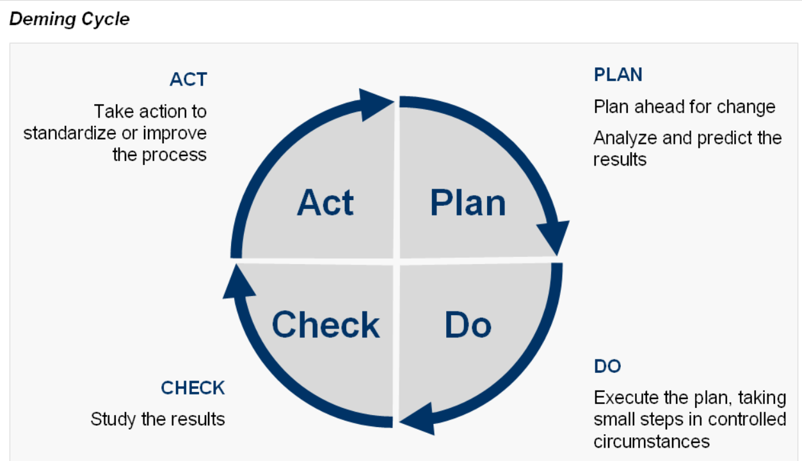
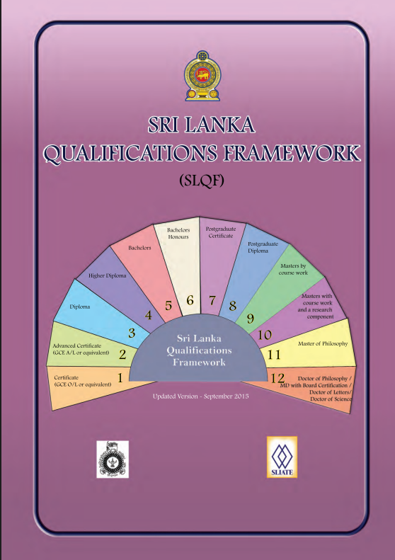
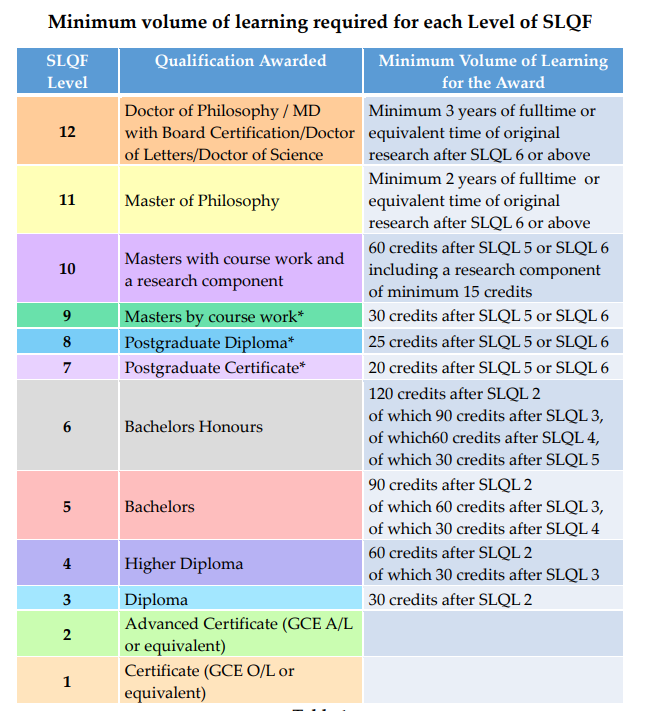

```{r setup, include=FALSE}
options(htmltools.dir.version = FALSE)
library(kableExtra)
```


```{r xaringan-themer, include=FALSE, warning=FALSE}
library(xaringanthemer)
style_mono_accent(
   base_color = "#0e1347",
   title_slide_background_color = "#0e1347",
  inverse_background_color = "#0e1347",
  header_font_google = google_font("Josefin Sans"),
  text_font_google   = google_font("Montserrat", "300", "300i"),
  code_font_google   = google_font("Fira Mono"),
  title_slide_text_color = "#ffea00",
  inverse_header_color = "#90c2d1",
   inverse_text_color = "#ffea00",
   header_background_text_color = "#90c2d1",
   text_font_size = "1.3rem",
  )
```


- Introduction to QA in Higher Education
- Internal Quality Assurance (IQA) and External Quality Assurance (EQA)
- Programme review and accreditation processes
- Curriculum development - Preparing course specifications and programme specifications
- Maintaining course files and academic documentation
- <span style="color:red;">Student feedback collection and analysis</span>
- <span style="color:red;">Continuous Quality Improvement (CQI) practices</span>
- <span style="color:red;">Introduction to the Sri Lanka Qualifications Framework (SLQF) and quality standards</span>
- <span style="color:red;">QA-related university policies, procedures, and circulars</span>
- <span style="color:red;">Global perspective on QA</span>

---

### What is QA?

A systematic process of maintaining and enhancing the quality of teaching, learning, assessment, research and academic management in higher education.

### Key Sri Lankan reference documents


1. [UGC Quality Assurance Handbook for Sri Lankan Universities](https://eugc.ugc.ac.lk/qac/downloads/QA_handbook.pdf) -	Overall QA principles and practices

2. [A to Z in Quality Assurance (UGC, 2015)](https://eugc.ugc.ac.lk/qac/downloads/A%20to%20Z%20in%20QA.pdf) - 	Introduction to QA terminology and concepts

3. [SLQF (2015)](https://eugc.ugc.ac.lk/qac/downloads/SLQF_2016_en.pdf)	National qualification levels and learning outcome expectations

4. [Quality Assurance Cell - University Grants Commission - Sri Lanka (Circulars, Publications & Letters)](https://eugc.ugc.ac.lk/qac/circulars.html)

<!--QA is not limited to external reviews. It is an ongoing responsibility embedded in teaching, assessment, academic administration and programme management.-->
---

### Internal Quality Assurance (IQA) and External Quality Assurance (EQA)

- **IQA**: Internal processes through which a university monitors, evaluates and improves its own academic activities.
- **EQA**: Periodic evaluation of an institution or programme by an external peer review team under the national QA framework.

Internal QA (IQA)	 | External QA (EQA)
---------------------|---------------------------
University CQA |	UGC Quality Assurance Council (QAC)
Faculty Quality Assurance Cell (FQAC) |	External peer review team
Internal self-evaluation |	Institutional Review (IR)
Course/programme monitoring	| Programme Review (PR)

---

### Important official documents for IQA and EQA

1. [UGC Circular No. 04/2015](https://eugc.ugc.ac.lk/qac/downloads/circulars/Com%20Cir_04_2015.pdf) – Establishment and strengthening of Internal Quality Assurance Units.

2. [Internal Quality Assurance Manual for Sri Lankan Universities (2014)](https://eugc.ugc.ac.lk/qac/downloads/Internal%20QA%20Manual%20-%202013.pdf) – Guidance on internal QA structures and responsibilities.

3. [Manual for Institutional Review (2023)](https://eugc.ugc.ac.lk/qac/downloads/IR-manual-january-2023.pdf) – Institutional-level external evaluation.

4. [Manual for Review of Undergraduate Study Programmes (2023)](https://fas.tc.esn.ac.lk/wp-content/themes/faculty/assets/pdf/fqac/Revised%20PR%20Manual%20Final%207th%20June.pdf) – Programme-level external evaluation.

---
### Programme Review and Accreditation Processes

- **Programme Review**: A systematic evaluation of the quality, effectiveness and standards of an individual academic programme.
- **Institutional Review**: An evaluation of the effectiveness of university-wide systems and processes for assuring academic quality.

**What is examined in programme reviews?**

- Programme design, curriculum and learning outcomes
- Teaching, learning and assessment methods
- Student admission, progression and achievement
- Student feedback and student support
- Learning resources and academic staff
- Programme management and continuous improvement
---
### Key official documents

Document | 	Purpose
---------------------|----------------
[Manual for Review of Undergraduate Study Programmes (2023)](https://eugc.ugc.ac.lk/qac/downloads/IR-manual-january-2023.pdf) , (2015) |	Standards, criteria and best practices for undergraduate programme review
[Manual for Review of Postgraduate Study Programmes](https://eugc.ugc.ac.lk/qac/downloads/PGPR-Manual.pdf) |	Guidance for postgraduate programme review
[Manual for Institutional Review (2023)](https://eugc.ugc.ac.lk/qac/downloads/IR-manual-january-2023.pdf)|	Evaluation of institutional QA systems
[Code of Practice on Programme Approval, Monitoring and Review](https://eugc.ugc.ac.lk/qac/downloads/Part%20V.%20Program%20approval,%20monitoring%20and%20review.pdf)	 | Guidance on programme development, approval and ongoing monitoring

---
-  Programme review and professional accreditation are not identical.
- UGC programme review - evaluates academic quality under the national QA framework
- Professional accreditation - Additionally assess compliance with discipline-specific professional standards.

**Examples:**
- Engineering – IESL: Evaluates engineering degree programmes against engineering education standards.
- [UGC Commission Circular No. 08/2018](https://www.ugc.ac.lk/attachments/2028_Comm%20Circular%208_2018.pdf?utm_source=chatgpt.com) requires **computing degrees** to align with ACM/IEEE international curriculum guidelines.
---
### Curriculum Development: Programme Specifications and Course Specifications


**Important QA requirements**

- Map Course Learning Outcomes (CLOs) to Programme Learning Outcomes (PLOs).
- Ensure alignment between learning outcomes, teaching activities and assessment.
- Check the programme's alignment with SLQF descriptors.
- Demonstrate progression in complexity across academic years.
- Follow university procedures for curriculum approval and revision.

---

Documents to consult

- [SLQF (2015)](https://eugc.ugc.ac.lk/qac/downloads/SLQF_2016_en.pdf) – Qualification descriptors and credit requirements.
- [UGC Code of Practice on Programme Approval, Monitoring and Review](https://eugc.ugc.ac.lk/qac/downloads/Part%20V.%20Program%20approval,%20monitoring%20and%20review.pdf).
- [UGC Manual for Review of Undergraduate Study Programmes (2023)](https://eugc.ugc.ac.lk/qac/downloads/PR-manual-final-1-Version-3-amended-28-Dec-2015-3.pdf).
- [Application for Approval of UG & PG Programs](https://eugc.ugc.ac.lk/qac/downloads/circulars/Application-for-Approval-of-UG-PG-Programs.pdf)
- [Applications for Programmes (New/Revision)](https://eugc.ugc.ac.lk/qac/downloads.html)
- University Curriculum Development Policy / Programme Approval Procedure.
- Faculty and university-approved Programme Specification and Course Specification templates.

---

### Maintaining Course Files and Academic Documentation

**Course File**: A structured collection of academic documents and evidence maintained for each course/module to demonstrate how the course was planned, delivered, assessed, evaluated and improved.

- Maintain an updated course file for every course offering.
- Keep evidence of actual delivery, **not just planned activities**.
- Retain assessment and moderation evidence according to university regulations.
- Document changes made in response to student feedback and examination performance.
- Ensure consistency between the approved course specification and actual delivery.
- Maintain electronic records with appropriate access controls and version management.

---

Relevant reference documents

- UGC Code of Practice on Assessment of Students.
- UGC Code of Practice on Student Feedback.
- UGC Code of Practice on External Assessors.
- UGC Manual for Review of Undergraduate Study Programmes (2023).
- University Examination Regulations and Examination Procedures.
- Faculty/CQA course-file guidelines and record-keeping templates.

---
class: center, middle, inverse


# Session 2

---
class: center, middle, inverse

## Student feedback collection and analysis

---

## Student feedback collection and analysis

# Student feedback is evidence. It is not, by itself, a verdict on quality.

- Student feedback is <span style="color:red;">one source of evidence </span> about the learning experience.
- Feedback can identify problems that academics may not see themselves.
- <span style="color:red;">Collecting feedback without responding to it creates survey fatigue and undermines trust. </span> --> **GAP**

---

### What should we collect feedback on?

Four areas of feedback

1. **1. Teaching & learning** (Clarity of explanations, pace, learning activities, accessibility of learning materials)

2. **2. Assessment** (Alignment with learning outcomes, feedback on assessments, workload)

3. **3. Resources & support** (LMS, labs, tutorial)

4. **4. Student experience** (Workload, scheduling, engagement)

<span style="color:red;">Every feedback question should have a potential use.
</span>


---
### Triangulation : use different types of evidence to understand the same issue.

- Student feedback --> What students experienced
- Assessment results --> What students demonstrated
- Student attendance --> What students demonstrated
- Peer observation --> What a colleague observed --> **Faculty Peer Review Guideline Document**
- Course and programme review --> What the evidence suggests at a wider level

<!--Validation-->

---

class: center, middle, inverse

# Peer Reviewer = "Critical friend"

--

A "critical friend" is a trusted person who combines genuine support with honest, constructive critique to help you improve your work or thinking.

---
### Tools and resources already available in the Sri Lankan QA system

- [UGC Code of Practice on Student Feedback](https://eugc.ugc.ac.lk/qac/downloads/Codes%20of%20Practice%20on%20Student%20Feedback.pdf)
- [UGC Code of Practice on Peer Observation](https://eugc.ugc.ac.lk/qac/downloads/Code%20of%20Practice%20on%20Peer%20Observation.pdf)
- Examination and assessment reports --> Moderation forms
- Internal undergraduate satisfaction surveys
- Graduate/employability surveys

---

class: center, middle, inverse

## Continuous Quality Improvement (CQI) practices


---
class: center, middle

## Continuous Quality Improvement (CQI) practices

.pull-left[

## Quality assurance

**Are we meeting the required standards?**

(Documentation , Monitoring, Evidence)]

.pull-right[

## Quality enhancement

**How can we make it better?**

(Innovation, Reflection, Improvement)]

---

### The Deming Cycle

Four-step iterative method for continuous process and quality improvement (PDCA (Plan–Do–Check–Act) PDSA (Plan–Do–Study–Act))

```{r   out.width = "60%", echo = FALSE, fig.cap='', fig.align='center'}


```

*image source* https://flevy.com/blog/wp-content/uploads/2016/12/pdca.png
---
class: center, middle, inverse

# "Closing the loop” is the most important part

---

Example : A closed-loop student feedback process

- **Collect** - Student feedback, assessment performance, progression data, peer observation
- **Analyse** - Identify trends, problems and possible causes
- **Act** - Decide and implement a targeted intervention
- **Evaluate** - <span style="color:red;">Check whether the intervention  made a difference</span>
- **Communicate** - <span style="color:red;">Inform students and relevant staff what was changed and why</span>

---
class: center

## Example of closing the loop

Students reported	|Lecturer action |	Evidence of follow-up
-------------------|--------------------|--------------------------
Tutorials were too short	|Added guided practice (Take home assignment)	| Participation and performance monitored
Assignment instructions were unclear	| Revised instructions and rubric |	Fewer clarification requests
Software access was difficult|	Added setup guide and alternatives|	Access problems monitored (Mid vs End Semester feedback)

---

class: center, middle, inverse

## Introduction to the Sri Lanka Qualifications Framework (SLQF) and quality standards

---
.pull-left[

[Sri Lanka Qualifications Framework (SLQF) ](https://www.ugc.ac.lk/attachments/1156_SLQF_2016_en.pdf)

- Nationally consistent framework for higher education qualifications 
- Defines 12 qualification levels, from certificates to doctoral degrees
- The expected learning outcomes at each qualification level.
- The minimum volume of learning required for each qualification.
- Entry requirements and opportunities to progress to higher qualifications.

].pull-right[
```{r   out.width = "90%", echo = FALSE, fig.cap='', fig.align='center'}


```

]

<!--BSc Honours degree is at SLQF Level 6.-->

---
class: middle

.pull-left[

```{r   fig.height=15, echo = FALSE, fig.cap='', fig.align='center'}


```
.
].pull-right[


The 30 credits after SLQF Level 5 represent the minimum additional learning required beyond a Bachelor's Degree to obtain a Bachelor's Honours Degree
]

<!--BSc Honours degree is at SLQF Level 6.-->
---


- The UGC's  [Manual for Review of Undergraduate Study Programmes (2019)](https://eugc.ugc.ac.lk/qac/downloads/PR-manual-final-1-Version-3-amended-28-Dec-2015-3.pdf) (Second Edition, 2023) is a key practical reference for academics and programme teams.
- It contains criteria, standards, best practices and guidance for self-evaluation of undergraduate programmes.

.pull-left[
### SLQF 

Defines what a degree should represent
].pull-right[ 

###Review Manual

Evaluates how well the degree programme delivers it.]


---

class: center, middle, inverse

## QA-related university policies, procedures, and circulars
---
class: center, middle

QA-related university policies, procedures, and circulars

# [UGC - Quality Assurance Council's official website](https://eugc.ugc.ac.lk/qac/index.html) 


```{r   out.width="20%", echo = FALSE, fig.cap='', fig.align='center'}


```

<!--Bookmark the UGC QA portal instead of searching for QA documents every time.-->

---

Key message

## QA documents are not just something to read. They are decision-making tools.

They tell us:
- What is required?
- Who has authority?
- What process should be followed?
- What evidence should be provided?
- What approval is required?
- What must be recorded?

---

### Global Perspective on Quality Assurance (QA)

- International QA Frameworks -  European Standards and Guidelines (ESG) (Europe), Quality Assurance Agency (QAA) (UK) and Tertiary Education Quality and Standards Agency (TEQSA) (Australia).
- Programme Accreditation- Independent evaluation against academic and professional standards.
- <span style="color:red;">External Review- Evaluation by independent local and international experts.</span>
- International Benchmarking - Comparing curricula, credits and learning outcomes with global universities.
- Stakeholder Engagement: Involving students, employers, alumni and indutry in curriculum revision
- Evidence-Based Evaluation - Using graduate outcomes, student performance and employer feedback.


---
class: center, middle, inverse
# UoM VISION

## To be a globally recognized University with an empowered environment for nurturing world-class graduates.

<!--Quality Assurance is the bridge between our university vision and its achievement-->
